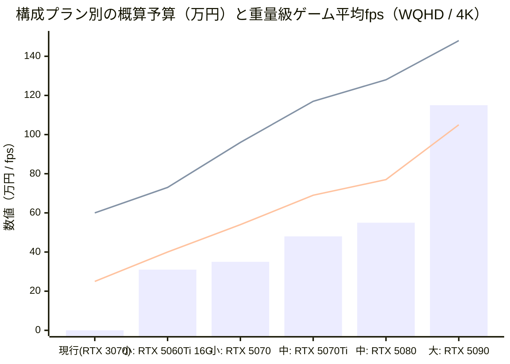
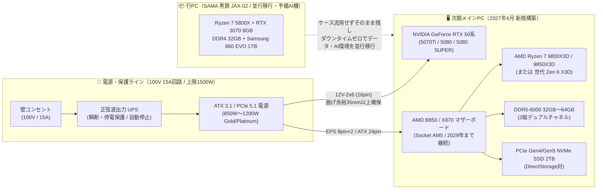
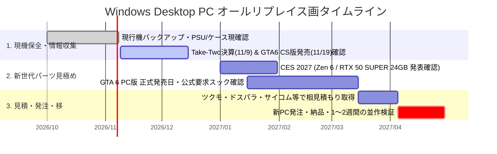

# 🖥️ Windows Desktop PC Replace (2027年4 オールリプレイス計画)

> [!IMPORTANT]
> **結論（エグゼクティブサマリー）**
> * **リプレイス目標時期**: **2027年4月**（『GTA 6』PC版の2027年Q1発売予測を受け、公要件と実測ベンチマークを確認して発注）
> * **基本アーキテクチャ**: **AMD Ryzen (Socket AM5)** × **NVIDIA GeForce RTX 50シリーズ** ＋ **ATX 3.1 (12V-2x6) 電源**
> * **大本命プラン**: **【中（竹）プラン】約47万〜62万円**（`Ryzen 7 9800X3D / 9850X3D` ＋ `RTX 5070 Ti / 5080 16GB` まは `RTX 50 SUPER 24GB` ＋ `DDR5 32〜64GB`）


---

## 📂 ドキュメント階層構成（目次）

本リポジトリは、トップペジ（本フイル）で全体・比較グラフ・早見表を示し、各テーマの掘り下げを `docs/` 配下に階層化して管理しています。

| ドキュメント | 内容・スコープ |
| :--- | :--- |
| **[`README.md`](./README.md)** | **全体ダッシュボード**（3プラン比較表・視覚グラフ・電源構成図・参考URL一覧） |
| **[`docs/01-current-pc-and-power.md`](./docs/01-current-pc-and-power.md)** | **現行Windows PC構成・電源構成**（2026年10月時点の実機診断値・ボトルネック分析・PSU/UPS設計） |
| **[`docs/02-gta6-pc-specs-analysis.md`](./docs/02-gta6-pc-specs-analysis.md)** | **GTA 6 PC版 発売時期＆要求スペック分析**（2027年Q1発売説の根と解像度別ターゲット要件） |
| **[`docs/03-build-plans-2027-04.md`](./docs/03-build-plans-2027-04.md)** | **2027年4月 予算別構成案（小・・大）**（パーツ別内訳・価格積算・RTX 50 SUPER / Zen 6 動向） |
| **[`docs/04-roadmap-and-checklist.md`](./docs/04-roadmap-and-checklist.md)** | **移行ロードマップ＆店頭相談チェックリスト**（2026年11月〜2027年4月の行動計画・並行移行手順） |
| **[`docs/05-prebuilt-bto-vs-diy.md`](./docs/05-prebuilt-bto-vs-diy.md)** | **完成品・BTO購入案（非自作）**：購入形態別メリット/デメリット、2027年向け同等構成、販売元比較、保証・拡張性、相見積もりテンプレート |

---

## 📊 1. 現行機 vs 2027年4月リプレイス構成（小・中・大）早見表

CPUを **AMD（Socket AM5）**、GPUを **NVIDIA（GeForce RTX 50系）** に固定した場合の現行機との比較一覧です

| 比較項目 | 🔹 現行機 (2020-2021年頃〜) | 🟢 【小（梅）】コスパ・WQHD構成 | 🟡 【中（竹）本命・4K＆AI両立 | 🔴 【大（松）】最高峰・ンスター構成 |
| :--- | :--- | :--- | :--- | :--- |
| **想定予算 (税込)** | 保持のみ | **約30万〜36万円** | **約47万〜62万円 ⭐本命** | **約100〜148万円** |
| **ターゲット用途** | フHD中画質 / 軽作業 | フルHD最高〜WQHD (1440p) 60fps+ | **WQHD高fps〜4K 60fps+ & AI常駐** | 4Kパストレ最高設定 & 27B級LLM |
| **CPU (AMD)** | Ryzen 7 5800X (8C/16T, AM4) | Ryzen 5 9600 / Ryzen 7 9700X | **Ryzen 7 9800X3D / 9850X3D** *(※Zen 6 X3D比較)* | **Ryzen 9 9950X3D / 9950X3D2** |
| **GPU (NVIDIA)** | GeForce RTX 3070 (**8GB**) | **RTX 5070 (12GB)** / 5060 Ti (16GB) | **RTX 5070 Ti (16GB)** / **RTX 5080 (16GB)** *(※24GB SUPER注目)* | **GeForce RTX 5090 (32GB)** |
| **メリ (RAM)** | DDR4 32GB (16GB×2) | DDR5 32GB (16GB×2) | **DDR5 32GB〜64GB (32GB×2)** | **DDR5 64GB〜128GB (64GB×2)** |
| **SSD** | 1TB SATA SSD (860 EVO) | 1TB〜2TB Gen4 NVMe | **2TB Gen4 NVMe** (DirectStorage対) | **4TB (2TB×2) Gen4/Gen5 NVMe** |
| **電源ユニット** | 既存ATX電 (型番未確認) | 750W〜850W Gold (ATX 3.1) | **850W〜1000W Gold/Platinum (ATX 3.1)** | **1200W Platinum/Titanium (ATX 3.1)** |

---

## 📈 2. 視覚グラフで見る予算・性能・VRAMバランス

### (1) プラン別の想定予算・VRAM容量・4Kゲーム性能イメージ

```
【想定予算の目安（万円）】
  現機維持  | █ 0〜3万円（検・バックアップのみ）
  🟢 小（梅） | ██████████ 30〜36万円（WQHD快適・AM5入門）
  🟡 中（竹） | █████████████████ 47〜62万円（★4K高画質＆ローカルAI両立のイートスポット）
  🔴 大（松） | ███████████████████████████████████ 100〜148万円（RTX 5090 32GB特化）

【GPU VRAM容量の比較（GB）】※GTA 6 高画質＆ローカルLLM駐の境界線は 16GB〜24GB
  RTX 3070 (現行)     | ███████ 8GB   (⚠️ WQHD以上・AI同時利用で不足)
  RTX 5070 (小プン) | ████████████ 12GB  (⭕ フルHD〜WQHD標準)
  RTX 5070 Ti / 5080  | ███████████████ 16GB  (✅ 4Kゲム軽量〜中量AIの実用ライン)
  RTX 50 SUPER (噂)   | ███████████████████████ 24GB  (🌟 2027年春に出れば中プランの最有力)
  RTX 5090 (大プラン) | ███████████████████████████████ 32GB  (👑 27B級LLM・画生成AIまで裕)
```

### (2) GPU別の想定予算（BTO/自作総額）とWQHD/4Kームレート比較（Mermaidチャート）


> * **棒グラフ（bar）**: 本体一式の概算予（万円）
> * **上段れ線**: WQHD（1440p）最高画質の平均fps安
> * **下段れ線**: 4K（2160p）最高画質の平均fps目安（DLSSマルチフレーム生成オフ時）


---

## ⚡ 3. 電源構成・ハードウェア刷新アーキテクチ

5〜6年使用した現行機（AM4 + SATA SSD + 旧規格電源）から、2027年4月の次期環境（AM5 + ATX 3.1電源 + UPS保護）へ刷新イメージです。



---

## 🗓️ 4. 2027年4月リプレイスに向けたスケジュール（Ganttチャート）



---

## 🔗 5. 参考記事・パーツ相場・BTOショップ URL一覧

リプレイス判断およびパーツ選定で参照している主要情報源のリンク集です。

### 📰 GTA 6 PC版 発売時期・要求スペック予測
| カテゴリ | タイトル・情報源 | 確認ポイント |
| :--- | :--- | :--- |
| **発売時期報道** | [PC Gamer: Report claims Grand Theft Auto 6 will launch on PC sooner than anyone expected](https://www.pcgamer.com/games/grand-theft-auto/report-claims-grand-theft-auto-6-will-launch-on-pc-sooner-than-anyone-expected/) | GamesBeatによる「2027年1〜3月（Q1）PC版発売」リーク報道（2026/10/14） |
| **発売時期報道** | [Tom's Hardware: GTA 6 could come to PC as early as Q1 2027, report claims](https://www.tomshardware.com/video-games/pc-gaming/gta-6-could-come-to-pc-as-early-as-q1-2027-leak-claims-january-march-launch-window-a-huge-improvement-over-18-month-gta-v-wait) | コンソール版（2026/11/19）から最短4ヶ月でのPC版投入測と背景分析 |
| **要求スペック予測** | [Eneba: GTA 6 System Requirements: Can Your PC Run It?](https://www.eneba.com/hub/games/game-guides/gta-6-system-requirements/) | 最低（RTX 3060）・推奨（RTX 4070 / 5800X）・4K UltraRTX 5080 / 9800X3D）の3段階予測 |
| **解像度別予測** | [FlowUP: GTA 6 PC: release date and system requirements (2026)](https://www.flowup.shop/en_GB/blog/jeux-9/gta-6-pc-release-date-and-system-requirements-291) | 1080p（RTX 5060）・1440pRTX 5070）・4K（RTX 5080 + 9800X3D）の構目安 |

### 🛠️ CPU / GPU 世代比較・算別ビルド相場（2026年10月時点）
| テゴリ | タイトル・情報源 | 確認ポイント |
| :--- | :--- | :--- |
| **CPU世代比較** | [ゲーミンスタイル: Nova Lake vs Zen 6、待つべきか今AM5か｜2027年のBFC対X3Dを乗換えコストで比較](https://gaming-st.com/cpu/nova-lake-vs-zen6-wait-or-buy-am5-2026-10/) | AM5の2029年サポート継続方針と、2027年のZen 6（Olympic Ridge）への乗換え判断 |
| **50万円台本命検証** | [ゲーミングPCガイド: 50万円台のおすすめゲーミングPC｜本命はRTX 5080＋9850X3D](https://gamepc-guide.com/articles/gaming-pc-500000/) | RTX 5080 + Ryzen 7 9800X3D / 9850X3D 搭載BTOの実売価格（49.5万〜54.8万円と4K実測fps |
| **GPU・AI用途比較** | [テコタク: RTX 5070 Ti/5080/5090どれを買う？用途別＋Super待つべき](https://techotakulab.com/rtx-5070ti-5080-5090-buy-guide-2026/) | 16GB VRAM（5070Ti/5080）と32GB（5090）の価格差、CES 2027のRTX 50 SUPER（24GB）予測 |

### 🛒 組立代行BTOショップ現行パーツ公式仕様
| ョップ / メーカー | リンク | 用途・チェック対象 |
| :--- | :--- | :--- |
| **TSUKUMO（ツクモ）** | [ツクモ公式通販サイト](https://shop.tsukumo.co.jp/) / [ナイトセール](https://shop.tsukumo.co.jp/features/night_sale/) / [G-GEAR 9800X3D+RTX5080構成例](https://shop.tsukumo.co.jp/goods/0409090978013/) | パーツ単体価格の基準・G-GEAR完成品（9850X3D+RTX5080+32GB+2TBで約55万円）・組立代行相談 |
| **FRONTIER（フロンティア** | [GeForce RTX 50シリーズ搭載デル特集](https://www.frontier-direct.jp/direct/e/ejRtx50/) | セール時のハイエンドBTO価格比較（RTX 5070 / 5070 Ti / 5080 / 5090搭載機） |
| **Sycom（サイコム）** | [サイコム BTO公式](https://www.sycom.co.jp/) | マザーボード・電源・空冷/水冷クーラーの番指定カスタム見積り |
| **パソコン工房** | [GeForce RTX 5070 Ti 特集・価格比較](https://www.pc-koubou.jp/pc/geforce_rtx_5070ti.php) | RTX 5070 Ti 単体パーツおよびBTO相場確認 |
| **ASRock（現行基板）** | [ASRock X570 Steel Legend 公式仕様](https://www.asrock.com/mb/AMD/X570%20Steel%20Legend/index.jp.asp) | 現行機のマザーボード仕様（AM4 / DDR4 / PCIe 4.0スロット構成） |
