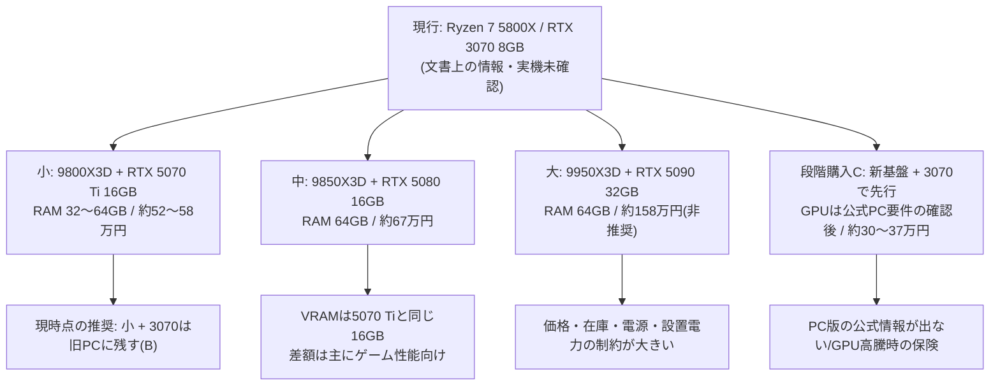
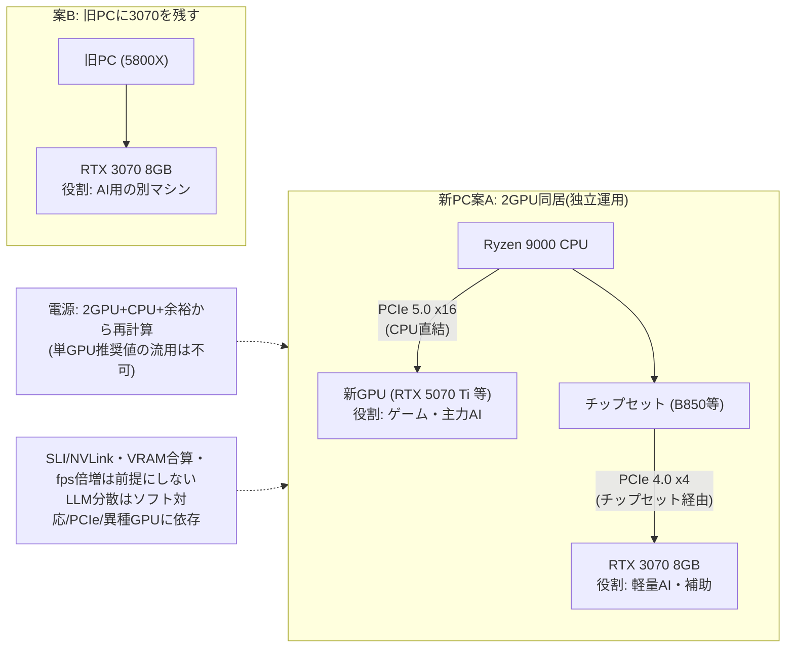
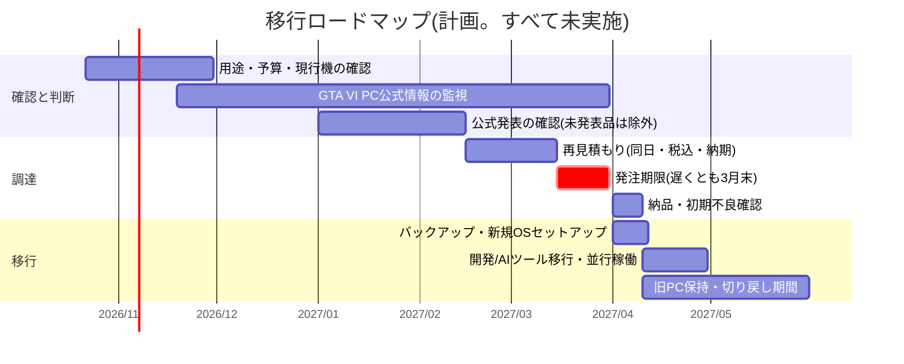

# 図の管理(Mermaid → Pele SVG)

- 編集元: [`src/*.mmd`](./src/)(Mermaid)
- 生成物: `svg/*.svg`(Pele で生成)
- 公式: [Pele](https://pele.run/) / [API](https://pele.run/api) / [互換性](https://pele.run/compatibility)(2026-10-22 確認)

## 現在の状態(2026-10-22)

**SVGは未生成です。** この作業環境(Windows)の `npm` が `registry.npmjs.org` への接続時に TLS ハンドシェイクエラー(`EPROTO` / SSL alert 40)で失敗し、`pele` の公開版を確認・固定できませんでした。接続制限の回避や無効化(`strict-ssl=false` 等)は行っていません。

そのため、`svg/` には生成物がなく、各文書からのSVGへのリンクも張っていません。下の Mermaid は **GitHub の標準表示による暫定プレビュー**です(最終形ではありません)。

## 確認できている Pele の事実(公式 API ページ)

- npm パッケージ名は `pele`。`render(source, options).svg` でSVG文字列が得られる(`width` / `height` / `type` も返る)。
- CLI は公式ページに記載がなく**未確認**。本リポジトリのスクリプトはライブラリ API のみを使う。
- Mermaid のテーマは効かず、色は CSS 変数で制御する。日本語フォントの扱いは公式ページに記載がなく、`fontFamily` オプションで指定して**目視確認が必要**。

## 再生成手順(接続可能な正式な環境で)

```bash
npm view pele version          # 公開済みバージョンを確認
npm install --save-exact pele  # 完全一致で固定し package.json / package-lock.json をコミット
npm run diagrams               # docs/diagrams/svg/*.svg を生成
```

代替: 公式 Playground で `src/*.mmd` を貼り付け、Copy SVG で `svg/` に保存(公開情報のみを入力すること)。

## 生成後の確認チェックリスト(未実施)

- [ ] 日本語の文字化け・欠け・文字切れ
- [ ] 矢印の向きと接続
- [ ] スマホ幅(約375px)での縮小表示と可読性
- [ ] ライト/ダーク背景での視認性
- [ ] README・各文書に `` で相対リンクし、編集元リンクと文章説明を併記

## 暫定プレビュー

### 構成比較(`src/plan-comparison.mmd`)



文章説明: 現行機から小・中・大・段階購入の4案に分岐。現時点では「小 + 3070を旧PCに残す(案B)」を推奨し、段階購入はPC版公式情報が出ない場合やGPU高騰時の保険。

### 2GPUの役割・接続(`src/dual-gpu-roles.mmd`)



文章説明: 案Aでは新GPUをCPU直結x16、3070をチップセット経由のx4スロットに載せ、ゲームと軽量AIを独立運用する。案Bは3070を旧PCに残すだけでPCIe・電源・熱の制約が発生しない。

### 移行ロードマップ(`src/roadmap.mmd`)



文章説明: 2026年末までに用途・予算・現行機を確認し、2027年2〜3月に再見積もり、3月末を発注期限、4月に納品・移行・並行稼働を行う。旧PCは検証完了まで消去せず、切り戻し期間を5月末まで残す。
